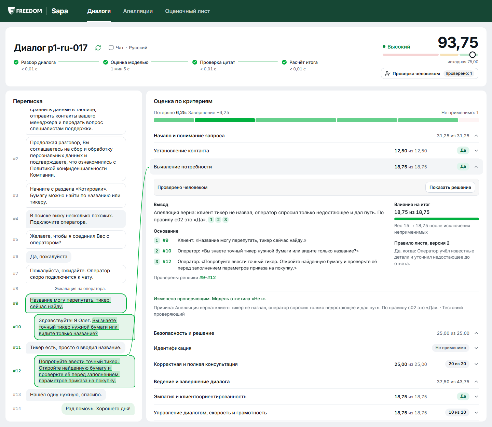
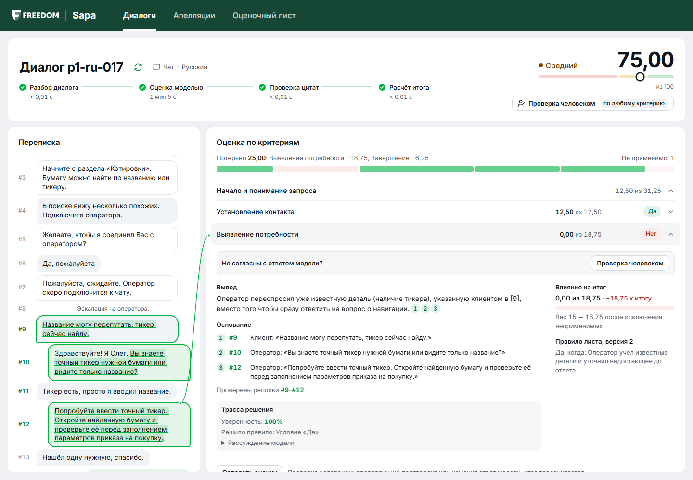
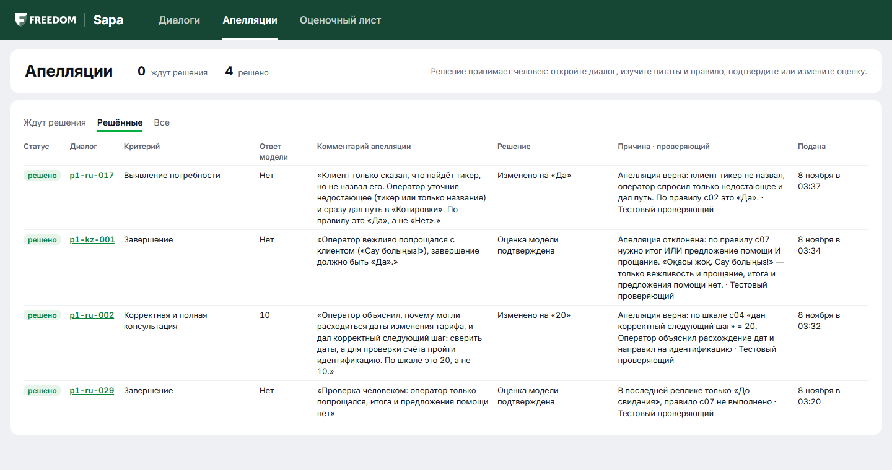
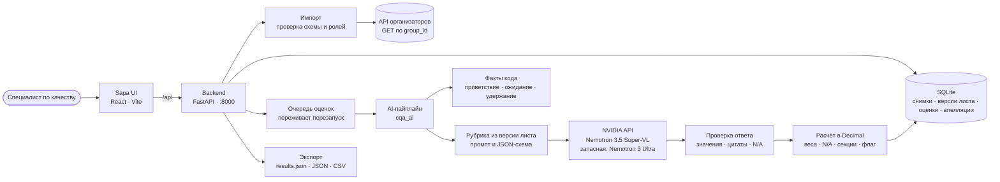

<div align="center">

<h1>🎧 Sapa · оценка качества диалогов</h1>

<p><em>Чек-лист из данных · AI читает каждую реплику · код считает баллы · последнее слово за человеком.</em><br/>
Прототип Conversation Quality Analytics для кейса Freedom Broker. Sapa оценивает работу оператора
в чатах и звонках по настраиваемому чек-листу, показывает по каждому критерию ответ, баллы,
обоснование и реплику-доказательство, принимает апелляции и пересчитывает итог. Сапа по-казахски
значит «качество».</p>

<p>
  
  
  
</p>

<p>
  
  
  
  
  
  
  
  
</p>

</div>

---

## Демо

<!-- ВИДЕО: замените эту строку ссылкой вида https://github.com/user-attachments/assets/... (на отдельной строке, без скобок и кавычек) -->

> 🎬 65 секунд с озвучкой: как AI читает переписку, находит сигналы в репликах, проходит чек-лист
> критерий за критерием и подтверждает каждый вывод точной цитатой. Затем грубое нарушение,
> расчёт с перераспределением весов, апелляция и новая версия чек-листа. Все диалоги в ролике
> синтетические. Файл: [`demo/sapa-demo-ru-voice.mp4`](demo/sapa-demo-ru-voice.mp4).

<p align="center">
  
</p>

## Содержание

- [Задача](#задача)
- [Что умеет Sapa](#что-умеет-sapa)
- [Результаты](#результаты)
- [Быстрый старт](#быстрый-старт)
- [Контрольный прогон](#контрольный-прогон)
- [Сценарий показа](#сценарий-показа)
- [Архитектура](#архитектура)
- [Гарантии в коде](#гарантии-в-коде)
- [Чек-лист и расчёт](#чек-лист-и-расчёт)
- [Модель, скорость и стоимость](#модель-скорость-и-стоимость)
- [Звонки](#звонки)
- [Переменные окружения](#переменные-окружения)
- [Сторонние компоненты и лицензии](#сторонние-компоненты-и-лицензии)
- [Ограничения](#ограничения)
- [Структура репозитория](#структура-репозитория)
- [Команда](#команда)

## Задача

Отдел качества брокера проверяет чаты и звонки операторов вручную: читает переписку, сверяет её с
чек-листом из восьми критериев и считает итог с весами. Это медленно, поэтому проверяется малая
доля разговоров, а оценки разных проверяющих расходятся.

**Кто пользуется:** специалист по качеству и проверяющий, который разбирает апелляции операторов.
**Что меняется:** каждый диалог получает объяснённую оценку по всем критериям за минуту, каждое
решение подкреплено репликой, а человек может оспорить и исправить любую оценку.

## Что умеет Sapa

- **Оценка по чек-листу.** Восемь критериев официального чек-листа: ответы Да/Нет/N/A и шкалы.
  Чаты на русском, казахском и английском, реплики бота и системные события служат контекстом.
- **Доказательства.** У каждого ответа есть короткое обоснование и реплика-доказательство. Код
  проверяет, что цитата дословно есть в реплике. Клик по ссылке ведёт к сообщению в переписке. Для
  пропущенного действия показан проверенный участок, для N/A названо выполненное условие.
- **Расчёт кодом.** Модель только выбирает ответ, баллы считает код в `Decimal`. При N/A веса
  перераспределяются, результаты секций и эффективные веса видны на экране. Грубое нарушение
  отмечается отдельным флагом.
- **Чек-лист как данные.** Критерии, формулировки, веса, тип ответа, N/A и шкалы меняются в
  интерфейсе («Оценочный лист» → «Сохранить версию N»). Промпт, JSON-схема ответа, проверка и
  расчёт строятся из сохранённой версии без правки кода.
- **Апелляция и решение.** Оператор оспаривает критерий с комментарием, проверяющий видит спорную
  оценку, комментарий и фрагмент, подтверждает или меняет её с причиной. Итог пересчитывается, в
  карточке видны исходная оценка, решение и финальный результат.
- **Звонки.** Расшифровки звонков оцениваются по отдельной голосовой версии чек-листа. Разговор
  с коллегой на удержании выделяется кодом и не засчитывается как ответ клиенту.
- **Объяснимость.** Сохраняются применённое правило рубрики, причина «почему не выше ступень»,
  рассуждение модели и уверенность, которую считает код. Критерии с низкой уверенностью
  подсвечиваются проверяющему.
- **Устойчивость.** Ограничение частоты запросов, повтор только при сбое, запасная модель, очередь
  оценок переживает перезапуск. Сбой модели не превращается в ноль баллов и не прячется из отчёта.

## Результаты

Сравнение с **нашей разметкой**, а не с Ground Truth организаторов: 65 DEV-диалогов, четыре
независимых разметчика, арбитр по 42 спорным решениям. DEV разбит на `tune` (настройка),
`compare` (выбор модели) и `holdout` (открыт один раз).

**Holdout:** 14 чатов (RU 8, KZ 3, EN 3) и 1 звонок, которые не использовались ни для настройки,
ни для выбора.

| Метрика | Super-VL (основная) | Ultra (запасная) |
|---|---|---|
| Совпадение по всем критериям, 14 чатов | **93%** | 92% |
| c01 / c02 / c03 / c04 / c05 / c06 / c07 / c08 | 100 / 93 / 100 / 79 / 100 / 79 / 93 / **100**% | 100 / 86 / 100 / 79 / 100 / 79 / 93 / 100% |
| MAE итогового балла / худшая ошибка | **2.49 / 14.6** | 4.83 / 17.3 |
| Грубые ошибки | пропущено 0, ложных 0 | пропущено 0, ложных 0 |
| Покрытие | 14/14 чатов и 1/1 звонок, 1.0 вызова на диалог | 14/14, один диалог оценила запасная модель после 429 |
| Скорость | p50 50 с, p95 90 с | p50 50 с, p95 83 с |

Для сравнения: два независимых разметчика на 15 самых трудных чатах совпадают в 88% решений.
Разметчик, читающий по-казахски, проверил все 15 KZ-чатов и совпал с эталоном на 92%.

**Генеральная репетиция, 8.11 в 07:00.** Ветка склонирована в пустую папку и запущена строго по
шагам «Быстрого старта», затем контрольный прогон на всём DEV, в 6.5 раза больше контрольного
набора:

| | Значение |
|---|---|
| Оценено полностью | **65 из 65**, сбоев 0, повторных раундов не понадобилось |
| Время | 1 024 с (17 минут) при 4 параллельных оценках, около 2.6 минуты на 10 диалогов |
| Чаты, 60 | совпадение 95%, MAE 3.24 |
| Звонки, 5 | совпадение 72%, MAE 17.7 |
| Стоимость | $0 |

Почти вся ошибка чатов приходится на семейство «ограничение на вывод» (3 чата), где сами
разметчики пометили решения как спорные. Звонков всего пять, и между прогонами они нестабильны,
поэтому их цифры — ориентир. Табло по чатам и звонкам: [docs/SCOREBOARD.md](docs/SCOREBOARD.md).

**Замена критерия.** На копии листа c05 заменён на бинарный «Самостоятельный путь для клиента», а
c06 — на шкалу 0/3/5 «Грамотность письма». Все 6 диалогов оценены по новому смыслу, старые
ступени не встречаются. Уточнения команды, написанные под старый смысл, отключаются
автоматически. Плюс 5 синтетических тестов: [ai/tests/test_criterion_swap.py](ai/tests/test_criterion_swap.py).

<details>
<summary>Оговорки к цифрам</summary>

- Первый прогон holdout признан недействительным: ревьюер нашёл в уточнении c07 фразы из двух
  holdout-диалогов. Примеры заменены, holdout прогнан заново. Обе цифры записаны в журнале
  [AGENTS.md](AGENTS.md), раздел 20.
- Справочные заметки о продукте ([freedom_support_notes_v1.md](ai/src/cqa_ai/references/freedom_support_notes_v1.md))
  составлены по повторяющимся ответам во всём DEV, и два пути меню встречаются только в
  holdout-диалогах. Это факты о продукте, а не примеры ответов, но цифра holdout по c04 из-за них
  может быть немного завышена.
- В чистой базе чек-листы получают номер версии 1. Их содержимое совпадает с последними версиями
  рабочей базы (чат v3, звонок v2), это проверено сравнением.

</details>

## Быстрый старт

Нужны Python 3.12 или новее, [uv](https://docs.astral.sh/uv/) и Node 24.

```bash
git clone https://github.com/alenisaw/fortochka-data-challenge.git
cd fortochka-data-challenge
cp .env.example .env
```

В `.env` заполните `CQA_API_URL` (ссылка на API организаторов без `group_id`, в одинарных
кавычках) и `NVIDIA_API_KEY` (создаётся бесплатно на
[build.nvidia.com](https://build.nvidia.com/settings/api-keys)).

Backend:

```bash
cd backend
uv sync
uv run uvicorn cqa_backend.main:app --port 8000
```

Frontend, во втором терминале:

```bash
cd frontend
npm install
npm run dev
```

Откройте адрес, который напечатает Vite, и импортируйте группу `DEV` на экране «Диалоги». Браузер
ходит в API через прокси Vite, поэтому CORS не нужен. Интерфейс без backend, на синтетических
данных: `npm run dev:mock`.

### Проверки

```bash
cd ai && uv run pytest          # 174 теста: рубрика, промпт, проверка ответа, расчёт, замена критерия
```

```bash
cd backend && uv run pytest     # 131 тест: импорт, очередь, апелляции, экспорт, файл для сдачи
```

```bash
cd frontend && npm run build    # проверка типов и сборка
```

## Контрольный прогон

```bash
cd backend
uv run python -m cqa_backend.control --group-id <значение от организаторов>
```

Команда импортирует ровно 10 записей и проверяет схему. Другие названия канала и ролей (`call`,
`Voice Call`, `agent`, `customer`, `оператор`, `клиент`) приводятся к стандартным, текст реплик не
меняется; метки времени принимаются в любом виде (ISO, `MM:SS`, `HH:MM:SS`, число). Затем она
оценивает записи, повторяет только сбои, проверяет полноту и пишет:

- `results/prod/results.json` — файл для сдачи в формате организаторов (JSON 1.0). Он проверяется
  автоматически: ровно 10 записей, без повторов ID, у каждой оценённой записи все 8 критериев,
  итог от 0 до 100. Для группы `DEV` файл без флага `--results-file` не пишется, чтобы репетиция
  не перезаписала сданный результат;
- JSON и CSV в `data/control/`;
- оценки в базу `backend/cqa.sqlite`, поэтому они сразу видны в интерфейсе.

После прогона файл нужно закоммитить и запушить до стоп-кода:

```bash
git add results/prod/results.json && git commit -m "Control results" && git push
```

Файл по DEV (`results/dev/results.json`, 65 записей) собирается так же из базы, где оценён DEV:

```bash
uv run python -m cqa_backend.results_file --group-id DEV --out ../results/dev/results.json --expected-records 65
```

<details>
<summary>Формат файла для сдачи</summary>

`criterion_id` — `contact`, `discovery`, `identification`, `consultation`, `empathy`, `dialogue`,
`closure`, `critical`; `value` — `true`/`false`, ступень шкалы или `null` для N/A;
`evidence_turns` нумеруются с 1 по исходному массиву реплик; `score.final_score` — итог по
чек-листу, `score.critical_flag` — грубое нарушение. Диалог без оценки получает `status: "error"`,
пустые критерии, `score: null` и причину. В файл идёт исходная AI-оценка, без учёта апелляций. У
звонков `rationale` — текст сработавшего правила рубрики, а не слова модели: в расшифровках есть
персональные данные.

</details>

Пошаговая ручная проверка всего продукта: [docs/MANUAL_TEST_GUIDE.md](docs/MANUAL_TEST_GUIDE.md).
Сценарий защиты: [docs/DEMO_SCRIPT.md](docs/DEMO_SCRIPT.md).

## Сценарий показа

1. **Диалоги.** Импортируйте группу `DEV` или загрузите свой транскрипт, выберите чек-лист и
   запустите оценку. Дэшборд показывает статус каждого диалога, итог и флаг грубого нарушения.
2. **Разбор диалога.** Переписка слева, критерии справа. Раскройте критерий: вывод, основание с
   номерами реплик, влияние на итог и правило листа. Клик по номеру реплики прокручивает переписку
   к ней, даже если у реплик одинаковое время.
3. **N/A и веса.** У неприменимого критерия объяснено условие, а веса остальных пересчитаны: это
   видно в блоке «Влияние на итог».
4. **Апелляция.** Нажмите «Проверка человеком», выберите критерий и оставьте комментарий.
5. **Решение.** На экране «Апелляции» проверяющий подтверждает или меняет оценку с причиной. Итог
   пересчитывается, в карточке видны исходная оценка, решение и финальный результат.
6. **Оценочный лист.** Измените формулировку, вес, шкалу или доступность N/A, сохраните новую
   версию и оцените диалог заново: новый смысл попадает в промпт и расчёт.

| До апелляции | Очередь апелляций |
|---|---|
|  |  |

## Архитектура



| Часть | Что внутри | Стек |
|---|---|---|
| [`frontend/`](frontend/) | Экраны «Диалоги», «Разбор диалога», «Апелляции», «Оценочный лист», отчёт | React 19, TypeScript, Vite, Tailwind |
| [`backend/`](backend/) | API, импорт, SQLite, очередь оценок, апелляции, экспорт, контрольный прогон | Python, FastAPI, pydantic, SQLite |
| [`ai/`](ai/) | Рубрика, промпт, вызов модели, проверка ответа, расчёт, сравнение моделей | Python, pydantic, httpx, OpenAI-совместимый клиент |
| [`design/`](design/) | Утверждённый макет и спецификация интерфейса | Markdown, HTML |

Как части связаны: [CONTRACTS.md](CONTRACTS.md). Полный контекст задачи и журнал решений:
[AGENTS.md](AGENTS.md). Интерфейс построен по [design/SAPA_UI_SPEC.md](design/SAPA_UI_SPEC.md).

## Гарантии в коде

| Гарантия | Где |
|---|---|
| Модель выбирает ответ, код считает баллы в `Decimal` с `ROUND_HALF_UP`, округляется только итог | [`scoring.py`](ai/src/cqa_ai/scoring.py) |
| Рубрика, промпт и JSON-схема ответа строятся из версии чек-листа, хардкода по `conversation_id` нет | [`rubric.py`](ai/src/cqa_ai/rubric.py), [`prompt.py`](ai/src/cqa_ai/prompt.py), [`checklists/`](ai/src/cqa_ai/checklists/) |
| При смене смысла критерия старые уточнения команды отключаются | [`rubric.py`](ai/src/cqa_ai/rubric.py) (`effective_notes`, `disabled_notes`) |
| Каждый критерий ровно один раз, значение из допустимых, ступени шкалы не интерполируются | [`validator.py`](ai/src/cqa_ai/validator.py) |
| Цитата должна дословно быть в указанной реплике, иначе она отбрасывается | [`validator.py`](ai/src/cqa_ai/validator.py) (`_match_quote`) |
| Сбой модели получает статус `failed` и остаётся в отчёте, а не превращается в ноль | [`contracts.py`](ai/src/cqa_ai/contracts.py), [`evaluations.py`](backend/src/cqa_backend/evaluations.py) |
| Незавершённые оценки продолжаются после перезапуска, готовые не повторяются | [`evaluations.py`](backend/src/cqa_backend/evaluations.py) (`recover`) |
| Действия бота не засчитываются оператору | [`prompt.py`](ai/src/cqa_ai/prompt.py) |
| Разговор с коллегой на удержании выделяется и не считается ответом клиенту | [`annotate.py`](ai/src/cqa_ai/annotate.py) |
| Уверенность считает код; низкая уверенность подсвечивает критерий, но не меняет оценку | [`confidence.py`](ai/src/cqa_ai/confidence.py) |
| Апелляция не переписывает исходную оценку и привязана к конкретному запуску и его версии листа | [`appeals.py`](backend/src/cqa_backend/appeals.py) |
| В файл для сдачи идёт исходная AI-оценка, без апелляций | [`results_file.py`](backend/src/cqa_backend/results_file.py) |
| Подписанные URL и ключи маскируются в логах и ошибках | [`redact.py`](backend/src/cqa_backend/redact.py) |
| Ограничение частоты запросов к API, запасная модель при сбое | [`ratelimit.py`](ai/src/cqa_ai/providers/ratelimit.py), [`profiles.py`](ai/src/cqa_ai/providers/profiles.py) |
| Реплика, похожая на инструкцию, остаётся данными и не меняет правила оценки | [`prompt.py`](ai/src/cqa_ai/prompt.py) |

## Чек-лист и расчёт

| ID | Секция | Критерий | Ответ | Вес |
|---|---|---|---|---|
| c01 | Начало и понимание запроса | Установление контакта | Да/Нет | 10 |
| c02 | Начало и понимание запроса | Выявление потребности | Да/Нет/N/A | 15 |
| c03 | Безопасность и решение | Идентификация | Да/Нет/N/A | 20 |
| c04 | Безопасность и решение | Корректная и полная консультация | 0–20/N/A | 20 |
| c05 | Ведение и завершение диалога | Эмпатия и клиентоориентированность | Да/Нет | 15 |
| c06 | Ведение и завершение диалога | Управление диалогом, скорость и грамотность | 0–10 | 15 |
| c07 | Ведение и завершение диалога | Завершение | Да/Нет/N/A | 5 |
| c08 | Грубые нарушения | Грубые ошибки | Да/Нет | без баллов |

```text
f(i) = 1 для Да, 0 для Нет, value / max_level для шкалы
S    = 100 · Σ(w_i · f_i) / Σ(w_i)   по применимым критериям с весом
```

Критерии с N/A исключаются, их вес пропорционально переходит к применимым, максимум остаётся 100.
Итог округляется до двух знаков. Если применимых критериев с весом нет, итог не рассчитывается.
c08 не влияет на балл: грубое нарушение показывается отдельным заметным флагом. Восемь
контрольных векторов из чек-листа проверены юнит-тестами.

## Модель, скорость и стоимость

| | |
|---|---|
| Оценщик | `nvidia/nemotron-3.5-super-vl-120b-a12b` (Nemotron 3.5 Super-VL), бесплатный API NVIDIA |
| Запасная модель | `nvidia/nemotron-3-ultra-550b-a55b` (Nemotron 3 Ultra), тот же API, включается при сбое основной |
| Стратегия | `single`: один вызов на все критерии, ответ по строгой JSON-схеме из чек-листа |
| Вызовов на диалог | 1.0 (повтор только при нарушении контракта ответа) |
| Токенов на вызов | чат: около 4 000 на вход и 8 000 на выход (модель рассуждает перед ответом); звонок: 6 200 и 11 400 |
| Скорость | чат: p50 35–51 с, p95 52–109 с; звонок: p50 57 с, p95 77 с; 10 диалогов при 4 параллельных — около 3–5 минут |
| Стоимость | **$0**: API бесплатный |
| Платный эквивалент | около **$0.005 за чат и $0.0066 за звонок** по публичной цене этой модели ($0.15 / $0.50 за 1M токенов, каталог OpenRouter, 7.11.2026); около $0.05 за 10 диалогов |

Модель меняется одной переменной: `LLM_MODEL=provider:model`, например
`nvidia:google/gemma-4-31b-it` или `local:qwen3:4b` (Ollama на этой машине). Профили провайдеров,
лимиты и цены: [profiles.py](ai/src/cqa_ai/providers/profiles.py).

### Как выбрана модель

Команда `uv run python -m cqa_ai.evaluation bench` прогоняет матрицу «модель × вариант пайплайна» и
пишет `leaderboard.md`. Подробный разбор с причинами каждого расхождения:
[docs/MODEL_COMPARISON.md](docs/MODEL_COMPARISON.md).

| Этап | Кандидаты | Итог |
|---|---|---|
| Дымовой тест, 7.11 и 8.11 | 15 сильнейших из 47 чатовых моделей каталога NVIDIA | Gemma 4, DeepSeek V4.1, gpt-oss-20b не отвечают за 120 с; Kimi K2.6, Nemotron 3 Super и ещё 5 недоступны ключу |
| `tune`, 28 чатов | Ultra, Super-VL, Gemma | Ultra 94%, 28/28. Gemma 92%, 25/28, p95 459 с. Super-VL 96–98%, но обрывает ответ на 8k токенов |
| `tune` + `compare`, 46 чатов и 4 звонка | Super-VL, Ultra, Mistral Large 4, Step-5, Gemma | **Super-VL: 95%, MAE 2.79**, звонки 78%; Ultra 92%, MAE 4.23, звонки 69%. Mistral и Step точны, но p50 4–7 минут и много таймаутов; Gemma 0/50 |
| `compare`, 18 чатов, 10 конфигураций | Ultra single, Super-VL, два судьи с арбитром, `vote`, `sections`, `per_criterion`, `second_opinion`, `self_check`, `facts_first` | **Ultra single: MAE 1.80–1.88**, совпадение 93–96%. Остальные: MAE 3.8–10.5. Сложнее не значит точнее |

**Почему основная Super-VL.** По набору `compare` выигрывала Ultra. На `tune`, `holdout` и звонках
Super-VL точнее (holdout MAE 2.49 против 4.83), всегда укладывается в один вызов, не даёт ложных
грубых нарушений на звонках и втрое дешевле. Поэтому 8.11 в 06:00 команда сделала её основной, а
Ultra запасной. Стабильность Ultra: два независимых прогона одних 18 чатов дали одинаковые ответы
в 96.5% решений.

Все стратегии реализованы и включаются настройкой `LLM_PIPELINE` (`single`, `sections`,
`per_criterion`, `facts_first`, `two_judges`, `vote`, `second_opinion`, `self_check`) вместе с
`LLM_SECOND_MODEL`, `LLM_ARBITER_MODEL`, `LLM_SECOND_CRITERIA`.

## Звонки

Мы оцениваем **текст расшифровки**, а не звук:

- расшифровки уже есть, своё распознавание речи не нужно; около $0.007 за звонок по публичной цене
  и около минуты;
- отдельная голосовая версия чек-листа (речь, паузы, удержание), чатовая не меняется; лист
  выбирается по каналу и правится в интерфейсе;
- разговор с коллегой на удержании выделяется кодом и не засчитывается как ответ клиенту;
- ошибки распознавания речи не штрафуются, `[Имя скрыто]` считается произнесённым именем;
- звонки оценивает та же модель, что и чаты; `CQA_ALLOW_VOICE_TO_CLOUD=0` оставляет их только
  локальной модели (профиль `local:`), для продакшена подойдёт и провайдер с договором о защите
  данных;
- из карточки звонка можно перейти к записи в плеере организаторов.

Точность на 5 звонках ниже, чем на чатах (72–78% против 93–95%): расшифровки сильно зашумлены.
Тексты звонков не попадают в Git, README, тесты и документы. Подробности: [ai/README.md](ai/README.md).

## Переменные окружения

Шаблон со всеми переменными: [`.env.example`](.env.example). Ключи живут только в `.env`, который
Git игнорирует.

| Переменная | По умолчанию | Назначение |
|---|---|---|
| `CQA_API_URL` | нет | API организаторов без `group_id`, в одинарных кавычках |
| `CQA_GROUP_ID` | `DEV` | Группа записей; для контроля значение сообщат организаторы |
| `NVIDIA_API_KEY` | нет | Ключ бесплатного API NVIDIA |
| `LLM_MODEL` / `LLM_FALLBACK_MODEL` | Super-VL / Ultra | Основная и запасная модель, `provider:model` |
| `LLM_PIPELINE` | `single` | Стратегия оценки |
| `LLM_MAX_OUTPUT_TOKENS` | `64000` | Лимит ответа рассуждающей модели |
| `CQA_LLM_TIMEOUT_S` | `420` | Таймаут одного вызова модели |
| `NVIDIA_RPM` | `35` | Запросов в минуту к NVIDIA |
| `CQA_ALLOW_VOICE_TO_CLOUD` | `1` | `0` оставляет звонки только локальной модели |
| `CQA_EVAL_CONCURRENCY` | `4` | Параллельных оценок в очереди |
| `CQA_EVAL_TIMEOUT_S` | `1500` | Сколько может занять один диалог со всеми повторами |

Необязательные бесплатные провайдеры (`GROQ_API_KEY`, `CEREBRAS_API_KEY`, `OPENROUTER_API_KEY`,
`GEMINI_API_KEY`) и локальный сервер (`LOCAL_LLM_BASE_URL`, по умолчанию Ollama) не используются,
пока ключ не задан.

## Сторонние компоненты и лицензии

| Компонент | Лицензия | Для чего |
|---|---|---|
| FastAPI, uvicorn, pydantic, pydantic-settings | MIT, BSD-3-Clause, MIT, MIT | API и проверка данных |
| httpx, openai, python-dotenv | BSD-3-Clause, Apache-2.0, BSD-3-Clause | Вызовы модели и настройки |
| SQLite | Public domain | Хранилище |
| React, React Router, lucide-react | MIT, MIT, ISC | Интерфейс и иконки |
| Vite, Tailwind CSS, TypeScript | MIT, MIT, Apache-2.0 | Сборка и стили |
| Inter (`@fontsource/inter`) | SIL OFL 1.1 | Шрифт интерфейса |
| pytest, uv | MIT, MIT/Apache-2.0 | Тесты и окружение |
| NVIDIA API (Nemotron 3.5 Super-VL, Nemotron 3 Ultra) | NVIDIA API Trial Terms; NVIDIA Open Model License | Оценщик |
| DEV-данные и чек-лист | Предоставлены организаторами | Настройка и проверка, в Git не хранятся |

## Ограничения

- **Цифры точности посчитаны по нашей разметке**, а не по Ground Truth организаторов. Разметка
  сделана командой и может расходиться с эталоном в спорных правилах (например, c07 и раскрытие
  статуса счёта в c08).
- Точность на звонках ниже, чем на чатах, и посчитана всего на 5 звонках.
- Звук не анализируется: дикция и интонация не оцениваются, из карточки звонка есть только переход
  к плееру организаторов.
- Справочника продуктов нет, поэтому правильность консультации (c04) модель проверяет по самому
  диалогу и заметкам, собранным из DEV.
- Авторизации нет: подача и проверка апелляции показаны как отдельные действия в интерфейсе.
  Запускайте на localhost или во внутренней сети.
- Бесплатный API NVIDIA ограничен по частоте запросов; при 429 включается запасная модель.

## Структура репозитория

```
.
├── frontend/      интерфейс Sapa (React, Vite, TypeScript)
├── backend/       API, импорт, SQLite, очередь, апелляции, экспорт, контрольный прогон (FastAPI)
├── ai/            рубрика, промпт, модель, проверка ответа, расчёт, сравнение моделей
├── design/        утверждённый макет и спецификация интерфейса
├── docs/          сравнение моделей, табло, сценарий защиты, ручная проверка, скриншоты
├── results/       файлы для сдачи: dev/results.json и prod/results.json
├── demo/          демо-ролик
├── AGENTS.md      полный контекст задачи и журнал решений
├── CONTRACTS.md   контракты между частями
└── .env.example   шаблон переменных окружения
```

## Команда

**«Форточка»**

| Участник |
|---|
| Исаев Ален Кайратович |
| Сейдалиев Нурбек Кайратович |
| Канымкулов Дамир Рафаэльевич |
| Нұрхиса Фарида |

Каждая часть меняет только свою папку в своей ветке (`feat/frontend`, `feat/backend`, `feat/ai`),
корневые файлы меняются отдельным коммитом в `main`. `.env`, `data/`, PDF и базы SQLite в Git не
попадают. Перед пушем проверяем, что в ветке нет подписанных ссылок:

```bash
git grep -nE "sig=|powerplatform\.com" $(git rev-parse --abbrev-ref HEAD) -- . ':!AGENTS.md' ':!README.md'
```

<div align="center">

Сделано командой **«Форточка»** на **Data Challenge'26** · кейс Freedom Broker · Conversation
Quality Analytics.

</div>
